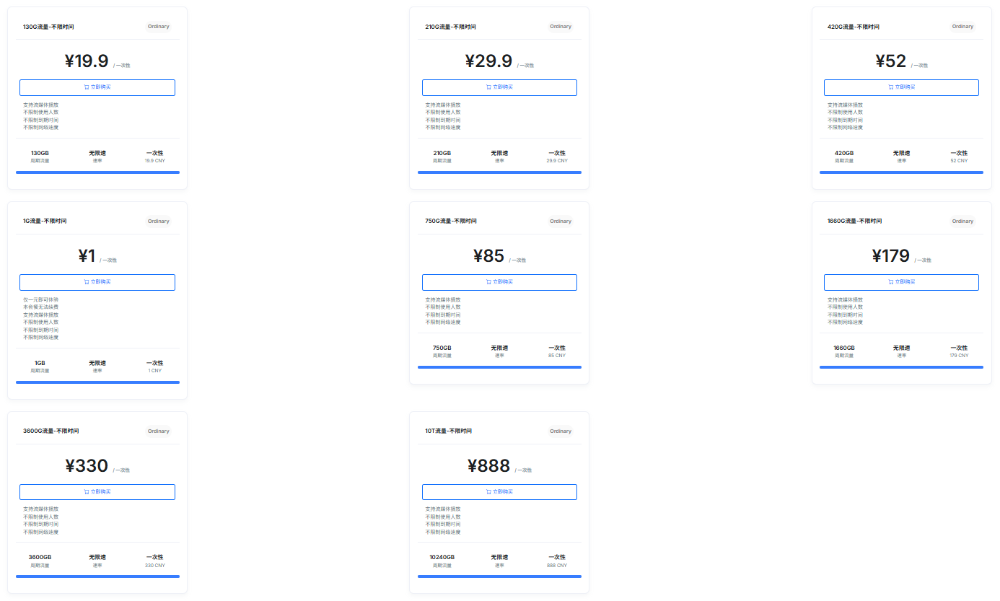

# Clash Verge Rev 配置教程｜Mihomo 内核 + 魔戒机场订阅指南（2026）

> **Clash Verge Rev 新手教程**：面向 Windows、macOS、Linux 用户，3 分钟完成客户端安装、订阅导入和节点选择。无需手写 YAML，配合 **魔戒机场** 订阅即可使用。

👉 **[注册魔戒机场 · 按量计费，不限时间](https://mojie.app/register?aff=Pvs1RARA)**

---

## 目录

- [先厘清三个名字](#先厘清三个名字)
- [3 分钟快速开始](#3-分钟快速开始)
- [客户端下载](#客户端下载)
- [推荐设置](#推荐设置)
- [常见问题](#常见问题)
- [魔戒机场推荐](#魔戒机场推荐)

---

## 先厘清三个名字

| 名称 | 定位 | 说明 |
|------|------|------|
| **Clash Verge Rev** | 桌面 GUI 客户端 | 新手直接安装使用，支持 Windows / macOS / Linux |
| **Mihomo** | 代理内核 | 原 **Clash Meta**，现已更名并持续维护 |
| **Clash Meta** | 旧名称 | 通常指 Mihomo 内核，或使用该内核的客户端 |

所以，**Clash Verge Rev 与 Clash Meta 不是替代关系**：前者是图形界面，后者是内核的旧称。新手认准 **「Clash Verge Rev + Mihomo 内核」** 即可；本教程后续统一使用 Mihomo 这一名称。

---

## 3 分钟快速开始

### 第一步：注册并获取订阅

1. 打开 **[魔戒机场注册页](https://mojie.app/register?aff=Pvs1RARA)**；
2. 按需购买流量包，流量不限使用时间；
3. 在用户中心的「订阅中心」复制 Clash 订阅链接。

### 第二步：安装 Clash Verge Rev

前往 [Clash Verge Rev Releases](https://github.com/clash-verge-rev/clash-verge-rev/releases)，下载与系统匹配的安装包：

- Windows：`.exe` 或 `.msi`
- macOS：选择与芯片匹配的 `.dmg`（Apple Silicon / Intel）
- Linux：`.deb`、`.rpm` 或 AppImage

### 第三步：导入订阅

1. 打开 Clash Verge Rev，进入 **订阅**；
2. 点击 **新建**，粘贴魔戒机场订阅链接；
3. 点击 **导入**，等待节点和策略组加载；
4. 进入 **代理**，选择节点或「自动选择」。

### 第四步：开启代理并验证

- 日常使用优先开启 **系统代理**；
- 仅当应用不遵循系统代理时，再按需开启 **TUN 模式**；
- 打开 ChatGPT、YouTube 或 Google 验证连通性。

👉 **[还没有订阅？立即注册魔戒机场](https://mojie.app/register?aff=Pvs1RARA)**

---

## 客户端下载

| 平台 | 推荐客户端 | 说明 |
|------|------------|------|
| Windows / macOS / Linux | [Clash Verge Rev](https://github.com/clash-verge-rev/clash-verge-rev) | 本教程主推，基于 Mihomo 内核 |
| Windows / macOS / Linux | [Mihomo Party](https://github.com/mihomo-party-org/mihomo-party) | 现代化界面，可选 |
| Android | [Clash Meta for Android](https://github.com/MetaCubeX/ClashMetaForAndroid) | 支持订阅导入 |
| iOS | [Stash](https://stash.ws/) | 付费客户端 |
| OpenWrt | [OpenClash](https://github.com/vernesong/OpenClash) | 路由器全局代理 |

> 客户端功能与系统兼容性以各自项目的最新 Release 说明为准。

---

## 推荐设置

### 代理模式

- **规则模式**：推荐默认使用，国内直连、境外代理；
- **全局模式**：仅在需要所有流量走代理时临时使用；
- **直连模式**：排查代理问题时使用。

### 节点与订阅

- 优先选择「自动选择」或延迟测试结果较好的节点；
- ChatGPT、Claude 等 AI 服务优先尝试香港、日本或美国节点；
- Netflix、YouTube 等流媒体优先尝试日本、新加坡或美国节点；
- 在 **订阅** 页面开启自动更新，机场节点变化后会自动同步。

### 系统代理与 TUN 怎么选？

- **系统代理**：占用低，适合浏览器和大多数桌面应用；
- **TUN 模式**：兼容性更好，适合游戏、终端等不读取系统代理的程序；
- 一般二选一即可，出现 DNS 或连接异常时再切换排查。

---

## 常见问题

<b>Clash Meta 和 Clash Verge Rev 有什么区别？</b>

Clash Meta 是内核的旧名称，现已更名为 **Mihomo**。Clash Verge Rev 是使用 Mihomo 内核的桌面图形客户端。两者是「界面」和「内核」的关系，不是同类软件。

<b>需要手动编写 config.yaml 吗？</b>

不需要。导入机场订阅后，Clash Verge Rev 会自动生成节点和策略组。只有需要自定义分流或高级功能时，才需要编辑配置。

<b>订阅导入失败怎么办？</b>

先确认订阅链接完整、未过期，并检查网络是否能正常访问机场官网。也可以在浏览器中打开订阅链接，确认返回的是 YAML 配置而不是错误页面。

<b>能访问境外网站，但国内网站变慢？</b>

切换到 **规则模式**，检查是否存在错误的全局代理或 DNS 设置。正常情况下，国内域名和 GeoIP-CN 应走直连。

<b>ChatGPT 或 Netflix 仍然无法使用？</b>

先切换不同地区节点，再更新订阅。流媒体和 AI 服务对节点 IP 较敏感，机场通常会针对这些服务优化线路，具体支持情况以官网说明为准。

<b>如何更新订阅？</b>

在 Clash Verge Rev 的 **订阅** 页面点击对应订阅的更新按钮；也可以在订阅设置中开启自动更新。

---

## 魔戒机场推荐

**[魔戒机场](https://mojie.app/register?aff=Pvs1RARA)** 采用按量计费模式，适合偶尔使用、AI 对话、流媒体和家庭多设备共享等场景。

| 流量 | 价格 | 适合人群 |
|------|------|----------|
| 130G | ¥19.90 | 首次试用、轻度使用 |
| 210G | ¥29.90 | 日常使用 |
| 420G | ¥52.00 | 中度用户，性价比高 |

套餐不限使用时间、不限设备数、不限速；价格和活动以官网当前页面为准。

👉 **[查看完整套餐与使用说明](https://github.com/fldyown/mojie)**
👉 **[立即注册魔戒机场](https://mojie.app/register?aff=Pvs1RARA)**

---

免责声明：本项目仅用于技术教程和信息分享。请遵守所在地法律法规及服务提供商的使用条款。
